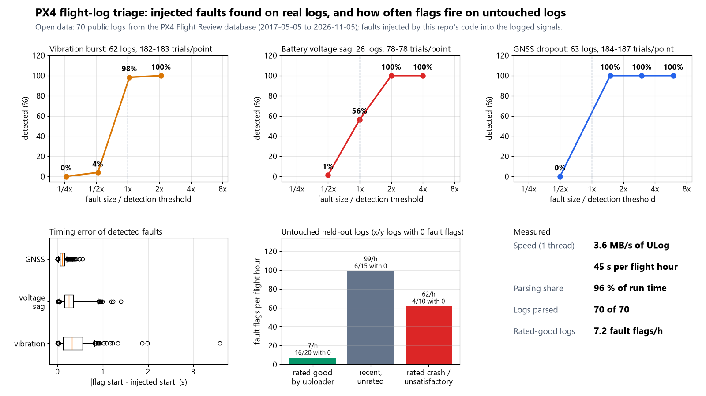
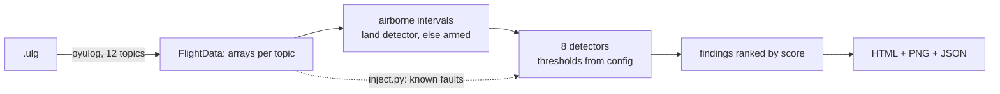

# px4-flightlog-triage

One command turns a PX4 drone flight log (ULog) into a ranked list of problems with timestamps and a one-page HTML/PNG summary. On 70 public logs, it found 100% of injected vibration, battery-sag and GNSS faults at twice the detection threshold.



## What it does

`flightlog-triage triage <log.ulg | folder>` parses the log with [pyulog](https://github.com/PX4/pyulog) (BSD-3) and checks the airborne part of the flight for:

| Kind | Signal | Default rule (all in `flightlog_triage/config.py`) |
|---|---|---|
| `vibration` | `sensor_combined` accel, high-passed (0.25 s mean removed), 1 s RMS, 3 axes | > 10 m/s2 for >= 2 s |
| `accel_clipping` | `accelerometer_clipping` bits or abs(axis) >= 152 m/s2 | >= 1 clipped sample in a 1 s window |
| `battery_sag` | voltage plus R x current, minus 30 s rolling median | dip > 0.12 V/cell for >= 1 s (needs a current signal) |
| `battery_low_voltage` | voltage per cell | < 3.3 V/cell for >= 2 s |
| `battery_high_resistance` | R from high-passed voltage vs current regression | > 20 mOhm per cell |
| `battery_sensor_implausible`, `battery_cell_count_mismatch` | voltage noise / readings above 4.5 V per cell | median 5 Hz step > 0.15 V/cell; > 5% of readings |
| `gnss_loss` | `fix_type` < 3, or no GNSS message, after the first in-flight fix | >= 1 s without a fix, or > 1.5 s silence |
| `gnss_poor` | `eph`, `satellites_used` | eph > 3 m or < 6 satellites for >= 3 s |
| `estimator_rejection` | `estimator_status` *_test_ratio | > 1.0 for >= 0.5 s (inf/NaN = source unused) |
| `rc_loss`, `datalink_loss` | vehicle-level lost flags (receiver frames only as fallback) | >= 0.5 s, only after the link was present |
| `motor_saturation` | `actuator_motors` (or PWM `actuator_outputs` + PWM params), multirotors only | a motor >= 0.95 for >= 0.5 s, or one motor <= 0.05 for >= 10 s |
| `cpu_load` | `cpuload.load` | > 0.90 for >= 1 s |
| `log_dropout` | gaps in `sensor_combined` | > 0.5 s; GNSS/RC gaps inside a dropout are not reported as faults |

Every finding gets a score (kind weight x how far past the threshold x duration, 0-100) and the list is sorted by it. Override any threshold with `--config my.json` (`{"vibration_warn_m_s2": 8}`); unknown keys are rejected.

## Results

Measured on 70 public multirotor logs (35 rated good by the uploader, 25 recent unrated, 10 rated crash or unsatisfactory), dated 2017-05-05 to 2026-11-05, 6.7 airborne hours, 1,077 MB. `results/eval.json` has every number.

**(a) Known faults injected into the real logs' signals** (3 random airborne times per log, fault type and size):

| Fault injected | Logs | Detected, by size relative to threshold | Timing error median / p95 |
|---|---|---|---|
| Vibration burst, 4 s (1.5/3/6/12 m/s2 per axis added) | 62 | 0.26x: 0%, 0.52x: 4%, 1.04x: 98%, 2.08x: 100% | 0.32 s / 0.82 s |
| Voltage sag, 3 s (0.06/0.12/0.24/0.48 V/cell) | 26 with current sensor | 0.5x: 1%, 1x: 56%, 2x: 100%, 4x: 100% | 0.25 s / 0.90 s |
| GNSS fix lost (0.5/1.5/3/6 s; minimum 1 s) | 63 | 0.5x: 0%, 1.5x: 100%, 3x: 100%, 6x: 100% | 0.10 s / 0.21 s |

Vibration noise is added per axis; the threshold is on the 3-axis RMS. There are 182-187 trials per point for vibration and GNSS, and 78 for sag.

**(b) Untouched logs, held-out set** (the 45 logs not looked at while choosing thresholds):

| Stratum | Logs | Airborne h | Fault flags / h | Logs with no fault flag | All flags / h |
|---|---|---|---|---|---|
| Rated good by uploader | 20 | 2.5 | 7.2 | 16 / 20 | 28.7 |
| Recent, unrated (2024-2026) | 15 | 1.1 | 99 | 6 / 15 | 105 |
| Rated crash / unsatisfactory | 10 | 1.1 | 62 | 4 / 10 | 78 |

"Fault flags" leave out logger dropouts, ground-link drops and battery configuration notes. Most of the other flags on the rated-good logs are logger dropouts (15.5 / h).

**(c) Hand check.** I chose 3 held-out rated-good logs on purpose (they had the most non-dropout flags) and checked all 33 flags against the plotted signals: 30 matched a real event, 2 vibration flags were borderline (that vehicle sat at 8-10 m/s2 all flight), 1 resistance estimate could not be checked. On 2 dev logs, 5 of 5 `log_dropout` flags matched dropout records the logger itself wrote. See `results/hand_check.csv`. A "real" flag is not always a problem: some rated-good flights include hard manoeuvres.

**(d) Speed, one thread:** 3.6 MB/s of ULog, 45 s per flight hour; pyulog parsing takes 96% of that.

**(e) Resistance estimate on simulated flights** (known R, 10 seeds each): reads 17% low at 5 mOhm/cell, 8% at 10, 3% at 20, 1% at 40.

## Quick start

```bash
uv venv .venv --python 3.12
uv pip install --python .venv/Scripts/python.exe -e ".[dev]"     # Linux/macOS: .venv/bin/python

python -m flightlog_triage triage my_flight.ulg --out report/    # ranked list + report/my_flight.html/.png/.json
python -m flightlog_triage triage logs_folder/ --out report/     # one report per log + index.html + summary.csv
python -m flightlog_triage demo                                  # offline: simulated flight, 8 injected faults
python -m flightlog_triage reproduce                             # fetch sample + evaluate + figures (README numbers)
python -m pytest -q
```

`reproduce` downloads about 1.1 GB in total, one log at a time. It keeps the parsed topics as `.npz` and only about 150 MB of raw logs in `cache/` (gitignored), so the cache stays under 300 MB.

## How it works



Detectors run on plain numpy arrays, not pyulog objects, so tests and fault injection can edit signals directly. `ulog_io.write_ulog` is a small ULog encoder, written from the file-format spec, that the tests use to build synthetic logs. The fault injectors (`inject.py`) add noise bursts, voltage dips, fix losses, RC loss, motor and CPU saturation and estimator rejections at known times.

## Data sources

- Source: PX4 Flight Review public log database (logs.px4.io). Its upload page states that logs marked public are shared under the **CC BY 4.0** licence (attribution "PX4"). That allows redistribution with attribution. This repo still commits **no logs**: they are large and contain GPS tracks. `flightlog-triage fetch` downloads a stratified random sample (seed 7) at run time. Log IDs and dates are listed in `results/per_log.json`.
- Sample filter: multirotor, EKF2, 4-20 min, firmware v1.6+, not SITL, 2017 or later. Strata: "rated good" (good/great, no error labels, no logged errors), "recent" (unrated, 2024+, v1.13+), "rated problem" (crash or unsatisfactory).
- Unit tests use only simulated flights.

## What is not verified yet

- No hardware: nothing was checked on a real vehicle or against a pilot's notes.
- Thresholds are defaults, not tuned per airframe. Vibration and motor limits in particular depend on the frame, the IMU and how the vehicle is flown.
- Dev / held-out split: I set the thresholds while looking at the first 25 logs (dev set). Three rule changes (GNSS gap 1.5 s, battery noise limit 0.15 V/cell, preferring vehicle-level RC flags) came after viewing 4 held-out logs, so the held-out numbers are not fully blind.
- Real-log labels are the uploader's rating plus my own judgement. The hand-check sample (3 logs, 33 flags) was chosen on purpose, not at random.
- Injected faults are simple shapes (white noise, trapezoid dips, fix drops). Real faults may look different.
- The internal-resistance estimate is only checked on simulated data, where it reads low for small resistances.

## Licence

MIT, Copyright (c) 2026 VB-Builds. Depends on pyulog (BSD-3-Clause), numpy and matplotlib.
